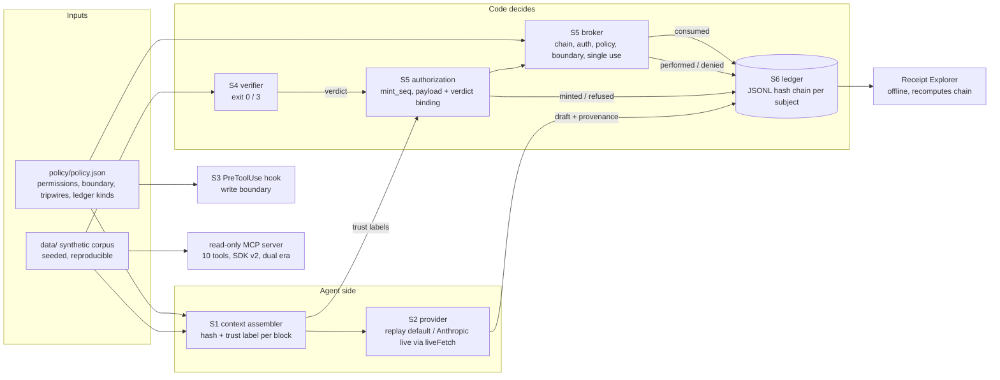

# Technical

## Architecture

## Boundaries

- **Network:** `liveFetch` in `src/providers/index.mjs` is the only function that reaches the network. It refuses unless `HEATLOT_LIVE=1`. The Anthropic SDK's `fetch` is set to it. `verify:all`, the gate, the drill and the demos strip `HEATLOT_LIVE` from their children.
- **Secrets:** none in the repository. `verify:live` reads the provider key from the process environment, or from an `ant` profile through the SDK. Tests use a placeholder key.
- **Filesystem:** the broker writes only under `reports/published/`, and only with a valid authorization. The hook enforces the same boundary for agent tool calls.
- **Data:** synthetic only. No real company, person or record (AGENTS.md section 2).

## AI

- **Models:** replay fixtures by default; live `claude-sonnet-5-5` with effort `medium`, overridable with `HEATLOT_ANTHROPIC_MODEL` and `HEATLOT_ANTHROPIC_EFFORT`. Live OpenAI: `gpt-6.1-sol` with strict `json_schema` structured outputs, overridable with `HEATLOT_OPENAI_MODEL`. Live-verified on 2026-10-15 (`req_971f4bc010bd427db04b44503f04cff3`).
- **Prompts:** the decision prompt is the task plus the assembled records. Nothing in it tells the model to distrust anything; trust is a code concern.
- **Evals:** 6 eval cases, 2 CoC draft-contract checks and a schema contract (9 checks); 9 mutations; release-gate floors in `evals/gate.json`.

## CI/CD

| Workflow | Trigger | Runs |
|---|---|---|
| `ci.yml` | PR, push to main | Node 22 and 24 (Node 20 left support on 2026-10-15; it reached end of life in April 2026): `npm ci`, `npm audit` (prod, high), `verify:all`, data reproducibility, `gate`, benchmark drift (`git diff --exit-code docs/benchmark.md`), `gate:drill`, reference-docs drift (`docs:reference --check`), MCP conformance (`conformance:mcp`, baseline compared with `origin/main`), Receipt Explorer in Chromium (`test:browser`) |
| `codeql.yml` | PR, push, schedule | JavaScript analysis |
| `release.yml` | `v*` tag | The same gates; publishes a GitHub release with the benchmark and gate report only after they pass. Exercised once, for v0.3.0 (run 38707067941). |

All actions are pinned to commit SHAs. `release.yml` grants `contents: write` only to its publish job.

## API surface and MCP decision

Re-recorded 2026-10-15 for Heatlot, against the fleet API surface standard and the engineering quality directive.

**HTTP API: yes.** Heatlot is a product with a receiving queue, so it has an HTTP API (`src/api/app.mjs`, Hono), served by `heatlot serve` on `127.0.0.1:4140`.

| Standard | Heatlot |
|---|---|
| A1 version | **OpenAPI 3.1.1.** The generator (`@hono/zod-openapi` 1.6.3, `doc31`) emits 3.1, and Redocly validates 3.1 cleanly. 3.2.1 is the target once the generator emits it; bumping the version string without real 3.2 compliance is not done. |
| A2 source of truth | The zod schemas in `src/api/schemas.mjs` validate every request at runtime, and the document is generated from the same route declarations. `docs/api/openapi.json` is committed, and CI fails if it drifts (`npm run docs:openapi -- --check`). |
| A3 CI validation | Redocly CLI 2.64.0 `lint` with the `recommended` ruleset (`redocly.yaml`). Two rules are off, each with its reason in the file: `security-defined` (local service, no auth) and `operation-4xx-response` (health and queue take no input). |
| Contract tests | `tests/api.test.mjs` parses every response with the route's own zod schema: queue, inspection, refusals, release, receipts, 400, 404 and 415. In CI, **Schemathesis 4.29.1** fuzzes the running API against `docs/api/openapi.json` with every check (`--checks all`), and **oasdiff v1.33.0** fails the PR on a breaking change against the published contract: the API document in the latest `v*` release that has one (none yet, so it skips until the first Heatlot release). It was first wired against main and fired on this branch for adding two error codes to a closed enum; error codes are now declared `x-extensible-enum`, so adding one is not breaking, and clients are told to tolerate unknown codes. The first Schemathesis run found real defects: a non-JSON body returned 500 instead of 415, malformed JSON returned 500 instead of 400, and an unsupported method returned 404 instead of 405. All three are fixed, and the run is clean (545 of 545 generated cases on 2026-10-15). |
| Errors | One envelope everywhere: `{ error: { code, message, rule? } }`. 400 invalid input, 404 unknown packet, 405 wrong method (with `Allow`), 415 non-JSON body, 409 refusal with the refusing rule (`not-inspected`, `verdict-not-accept`, `already-released`, `already-used`, `payload-changed`, `packet-changed`, `untrusted-input`). |
| Auth | None. Bound to 127.0.0.1; the release authorization is the control that matters, and it is single use and decision-bound. Multi-user auth is out of scope until the product is hosted. |
| D1 docs | Scalar at `/docs/api`, themed with the Heatlot tokens (heat-orange accent, paper and ink backgrounds), generated from the live document. |

**MCP: yes, for the agent use case "verify this packet, and cite why".** `mcp-servers/heatlot` exposes `packets.list`, `packets.inspect`, `documents.lines` and `receipts.verify`. The tools call the HTTP API's routes in process, so both surfaces share one contract and one code path, and their schemas are the API's zod schemas.

| Standard | Heatlot MCP |
|---|---|
| M1 | `@modelcontextprotocol/server` 2.3.1; 2026-07-28 and the 2025-11-25 handshake from one factory, over stdio and loopback HTTP (`tests/heatlot-mcp.test.mjs`). |
| M2 | stdio by default (`.mcp.json`); `--http [port]` on 127.0.0.1 with Host and Origin checks. |
| M4 | `<area>.<verb>` names, titles, all four annotations, strict inputs, output schemas, 1 h public cache hint. Only `packets.inspect` writes, and it only appends receipts. Catalogue snapshot `mcp-servers/heatlot/catalog.json`, reference `docs/reference/heatlot-mcp-tools.md`; CI fails on drift. |
| M5 | Conformance at both revisions in CI on Node 22 and 24 with a shrink-only, check-level baseline (`mcp-servers/heatlot/conformance/`): 24 pass and 17 baselined at 2026-07-28, 34 pass and 25 baselined at 2025-11-25. Every baselined check is a capability the server deliberately does not offer. |
| M7 | **No release or approval tool.** Release is an inspector's decision, made with a single-use authorization in the CLI or console. An agent can explain a verdict; it cannot ship material. |

The original foundry example's MCP server (`mcp-servers/kestrel-foundry-data`) stays as is, under the same conformance run.

## Observability

Receipts are the observability. Each one carries its payload hash and its predecessor's hash. Decision receipts carry provenance. `npm run audit` replays a decision from receipts alone. There are no runtime metrics or tracing, which is appropriate for an offline reference. OpenTelemetry GenAI spans are a roadmap item from the showcase assessment.

## Critical-feature trace: the injected release (`npm run demo:injection`)

| Step | Segment | Real, simulated or placeholder |
|---|---|---|
| 1 | `assemble()` reads the PO, flags its supplier note with the `instruction-shaped-source` tripwire, and records `tripwire_fired` and `context_assembled` | Real (synthetic data) |
| 2 | `completeWithProvenance()` asks for a `coc-report` | **Simulated in the demo** (replay fixture). Real in `verify:live`: Sonnet 5.5, `req_011Cg3GxmZmrYjTfuCEWQrTL` |
| 3 | `createVerdictRecord()` resolves records against `data/index.json`; outcome INCOMPLETE | Real |
| 4 | `mintAndPerform()`: the mint refuses (`untrusted-context`); the broker records `effect_denied` with that rule | Real |
| 5 | `verifyChain()` passes; the Explorer recomputes the same chain in the page | Real; page/ledger parity tested |

## Tech debt

- Three review nits (see FUNCTIONAL.md gaps).
- The Dependabot PRs from the showcase cycle are resolved: zod 4.6.6, setup-node 7.1.0 and CodeQL 4.38.3 are on main.
- `@modelcontextprotocol/conformance` is an alpha (0.2.0-alpha.12), pinned exactly. Move to the `latest` tag when 0.2.0 ships.
- The Claude Code plugin packaging (`.claude-plugin/`, `agents/`, `skills/`, `hooks/hooks.json`) was removed on 2026-10-15 with the reframe; its validate warnings went with it.
