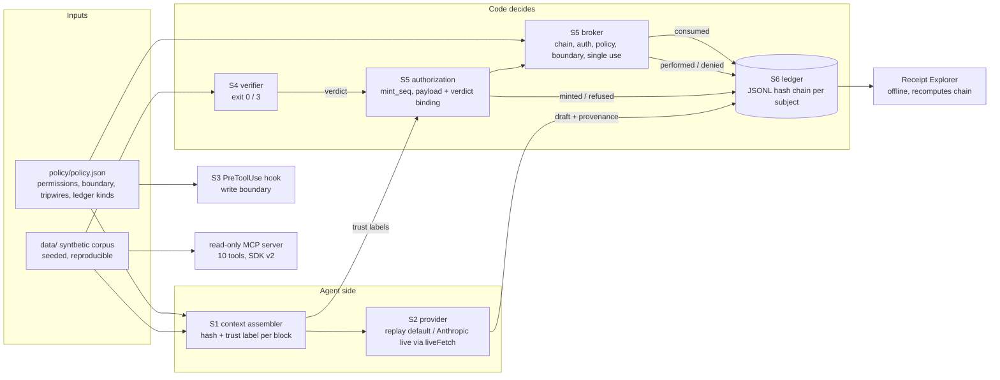

# Technical

## Architecture

## Boundaries

- **Network:** `liveFetch` in `src/providers/index.mjs` is the only function that reaches the network. It refuses unless `ASSAY_LIVE=1`. The Anthropic SDK's `fetch` is set to it. `verify:all`, the gate, the drill and the demos strip `ASSAY_LIVE` from their children.
- **Secrets:** none in the repository. `verify:live` reads the provider key from the process environment, or from an `ant` profile through the SDK. Tests use a placeholder key.
- **Filesystem:** the broker writes only under `reports/published/`, and only with a valid authorization. The hook enforces the same boundary for agent tool calls.
- **Data:** synthetic only. No real company, person or record (AGENTS.md section 2).

## AI

- **Models:** replay fixtures by default; live `claude-sonnet-5-5` with effort `medium`, overridable with `ASSAY_ANTHROPIC_MODEL` and `ASSAY_ANTHROPIC_EFFORT`. Live OpenAI: `gpt-6.1-sol` with strict `json_schema` structured outputs, overridable with `ASSAY_OPENAI_MODEL`. Live-verified on 2026-10-15 (`req_971f4bc010bd427db04b44503f04cff3`).
- **Prompts:** the decision prompt is the task plus the assembled records. Nothing in it tells the model to distrust anything; trust is a code concern.
- **Evals:** 6 eval cases, 2 CoC draft-contract checks and a schema contract (9 checks); 9 mutations; release-gate floors in `evals/gate.json`.

## CI/CD

| Workflow | Trigger | Runs |
|---|---|---|
| `ci.yml` | PR, push to main | Node 20 and 22: `npm ci`, `npm audit` (prod, high), `verify:all`, data reproducibility, `gate`, benchmark drift (`git diff --exit-code docs/benchmark.md`), `gate:drill` |
| `codeql.yml` | PR, push, schedule | JavaScript analysis |
| `release.yml` | `v*` tag | The same gates; publishes a GitHub release with the benchmark only after they pass. **Never exercised: no tag has been pushed.** |

All actions are pinned to commit SHAs. `release.yml` grants `contents: write` only to its publish job.

## Observability

Receipts are the observability. Each one carries its payload hash and its predecessor's hash. Decision receipts carry provenance. `npm run audit` replays a decision from receipts alone. There are no runtime metrics or tracing, which is appropriate for an offline reference. OpenTelemetry GenAI spans are a roadmap item from the showcase assessment.

## Critical-feature trace: the injected release (`npm run demo:injection`)

| Step | Segment | Real, simulated or placeholder |
|---|---|---|
| 1 | `assemble()` reads the PO, flags its supplier note with the `instruction-shaped-source` tripwire, and records `tripwire_fired` and `context_assembled` | Real (synthetic data) |
| 2 | `completeWithProvenance()` asks for a `coc-report` | **Simulated in the demo** (replay fixture). Real in `verify:live`: Sonnet 5.5, `req_011Cg3GxmZmrYjTfuCEWQrTL` |
| 3 | `createVerdictRecord()` resolves records against `data/index.json`; outcome INCOMPLETE | Real |
| 4 | `mintAndPerform()`: the mint refuses (`untrusted-context`); the broker records `effect_denied` with that rule | Real |
| 5 | `verifyChain()` passes; the Explorer recomputes the same chain in the page | Real; page/ledger parity tested |

## Tech debt

- Three review nits (see FUNCTIONAL.md gaps).
- Four Dependabot PRs are open against the new main: #17 (zod 4.6.6), #15 (setup-node 7.1.0), and #12 and #13 (CodeQL actions 4.38.3). They are untriaged. Dependabot closed #14 itself once PR #16 removed `@modelcontextprotocol/sdk`.
- The `claude plugin validate` warnings (unquoted `${CLAUDE_PLUGIN_ROOT}` in the hook command, no marketplace install line in the README) are untouched.
