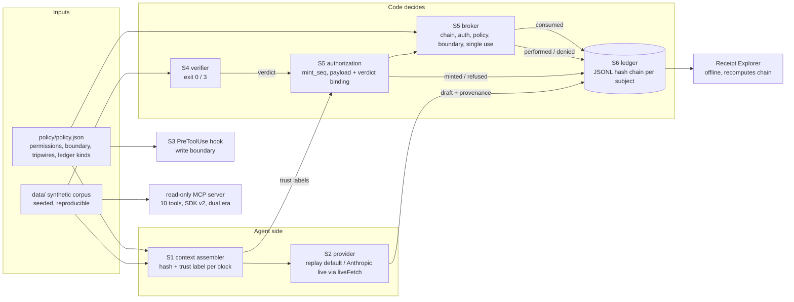

# Technical

## Architecture

## Boundaries

- **Network:** `liveFetch` in `src/providers/index.mjs` is the only function that reaches the network. It refuses unless `HEATLOT_LIVE=1`. The Anthropic SDK's `fetch` is set to it. `verify:all`, the gate, the drill and the demos strip `HEATLOT_LIVE` from their children.
- **Secrets:** none in the repository. `verify:live` reads the provider key from the process environment, or from an `ant` profile through the SDK. Tests use a placeholder key.
- **Filesystem:** the broker writes only under `reports/published/`, and only with a valid authorization. The hook enforces the same boundary for agent tool calls.
- **Data:** synthetic only. No real company, person or record (AGENTS.md section 2).

## AI

- **Models:** replay fixtures by default; live `claude-sonnet-5-5` with effort `medium`, overridable with `HEATLOT_ANTHROPIC_MODEL` and `HEATLOT_ANTHROPIC_EFFORT`. Live OpenAI: `gpt-6.1-sol` with strict `json_schema` structured outputs, overridable with `HEATLOT_OPENAI_MODEL`. Live-verified on 2026-10-15 (`req_971f4bc010bd427db04b44503f04cff3`).
- **Prompts:** the decision prompt is the task plus the assembled records. Nothing in it tells the model to distrust anything; trust is a code concern.
- **Evals:** 6 eval cases, 2 CoC draft-contract checks and a schema contract (9 checks); 9 mutations; release-gate floors in `evals/gate.json`.

## CI/CD

| Workflow | Trigger | Runs |
|---|---|---|
| `ci.yml` | PR, push to main | Node 22 and 24 (Node 20 left support on 2026-10-15; it reached end of life in April 2026): `npm ci`, `npm audit` (prod, high), `verify:all`, data reproducibility, `gate`, benchmark drift (`git diff --exit-code docs/benchmark.md`), `gate:drill`, reference-docs drift (`docs:reference --check`), MCP conformance (`conformance:mcp`, baseline compared with `origin/main`), Receipt Explorer in Chromium (`test:browser`) |
| `codeql.yml` | PR, push, schedule | JavaScript analysis |
| `release.yml` | `v*` tag | The same gates; publishes a GitHub release with the benchmark and gate report only after they pass. Exercised once, for v0.3.0 (run 38707067941). |

All actions are pinned to commit SHAs. `release.yml` grants `contents: write` only to its publish job.

## API surface and MCP decision

Recorded 2026-10-15 against the fleet API surface standard and the engineering quality directive.

**`packages/broker` (`@heatlot/broker`, internal) is the programmatic API.** A zero-dependency ESM library (`Broker`, `trusted`, `untrusted`, `verifyChain`, `startProxy`) and a CLI (`keygen`, `approve`, `verify`, `mcp-proxy`). Its contract is its README and its 17 tests; its six guards are in the mutation harness.

**No HTTP API, so no OpenAPI and no Scalar page.** Heatlot is an offline CLI and library. Its programmatic surfaces are the typed decision schemas, the MCP server and the receipt format. Adding an HTTP service only to document it would contradict the offline boundary above.

**JSON Schema is the contract.** Each decision has one canonical JSON Schema 2020-12 file in `schemas/`. The Anthropic adapter derives a strict tool from it, the OpenAI adapter derives a strict structured output, and Ajv validates every result against the canonical schema before use. That re-check matters because both vendors' strict modes drop some constraints (`minimum`, `if`/`then`, `allOf` and others). [docs/reference/decision-schemas.md](../reference/decision-schemas.md) is generated from the schemas and the adapters, and lists exactly what each provider drops.

**MCP: justified, read-only.** The agent use cases are real: an agent looks up NCRs, heat lots, purchase-order certification status and audit gaps with hash-verified citations, without reading `data/` directly. Every tool is a read-only lookup. Nothing that writes, ships, signs or sends is exposed; side effects stay with the effect broker. `npm run tools:report` lists the tools deliberately not added, and why.

| Standard | Heatlot |
|---|---|
| M1 SDK and era | `@modelcontextprotocol/server` 2.3.1. Serves 2026-07-28 and the 2025-11-25 handshake from one factory, over stdio (`serveStdio`) and over Streamable HTTP (`createMcpHandler`). `smoke:mcp` checks both eras on both transports. |
| M2 transport | stdio by default (what `.mcp.json` launches). `--http [port]` serves Streamable HTTP on `127.0.0.1` only, with Host and Origin checked against localhost; a foreign Origin gets 403 (tested). |
| M3 authorization | Not applicable: local, single-user, no credentials, synthetic data only. |
| M4 catalogue | Every tool has a title, all four annotations, a strict input schema (`additionalProperties: false`) and an output schema with `structuredContent`. The `tools/list` result is snapshotted to [catalog.json](../../mcp-servers/kestrel-foundry-data/catalog.json) and rendered to [docs/reference/mcp-tools.md](../reference/mcp-tools.md); CI fails on drift. `tools/list` and `server/discover` carry a one-hour public cache hint. |
| M5 conformance | `@modelcontextprotocol/conformance` 0.2.0-alpha.12, pinned as a devDependency, at 2026-07-28 and 2025-11-25 in CI on Node 22 and 24, and in the release gate. The committed baselines may only shrink (see below). |
| M6 discovery | `server/discover` comes from the SDK. No Server Card, because there is no hosted endpoint. Not registered in AgentHub's `registry/mcps.json`, because this server serves a synthetic demo dataset, not a fleet capability. |
| M7 approval | Not applicable: no tool has a side effect. |

**Conformance results.** At 2026-07-28: 24 checks pass and 17 are expected failures. At 2025-11-25: 34 pass and 25 are expected failures, plus 1 warning. Every expected failure is a feature the server deliberately does not offer: resources, prompts, completion, logging, sampling and elicitation, or the suite's own `test_*` fixture tools. Every core check passes: initialize, ping, tools/list, DNS-rebinding protection and wire-schema validity of every message. The warning is the 2025-era HTTP fallback issuing no session ID, which is correct for a stateless server. The baselines (`mcp-servers/kestrel-foundry-data/conformance/*.yml`) list checks, not whole scenarios, so the wire-schema check inside each excluded scenario is still enforced. The run fails on an unexpected failure, on a baselined check that starts passing, and on any entry added relative to `origin/main`.

**Deviations from the standard, kept on purpose:**
- Tool names are snake_case (`get_purchase_order`), not `<area>.<verb>`. The eval cases, replay fixtures and film all use these names, and renaming them would break recorded evidence for no functional gain.
- The catalogue lives beside its server at `mcp-servers/kestrel-foundry-data/catalog.json`, not at `mcp/catalog.json`.
- No resources or prompts. The tools already return hash-verified bodies, and the key workflows are the CLI demos.

**Gaps found and fixed by this work (2026-10-15):**
- Tool inputs silently dropped unknown arguments. For example, `list_ncrs({ statuss: 'open' })` returned the unfiltered list as if it were an answer. Inputs are now strict objects. `smoke:mcp` asserts that the call is refused, and that check fails against the old schemas.
- `tools:report` carried a hand-written copy of every input schema that had drifted from the server: it claimed `additionalProperties: false`, which the server did not emit. It now reads the generated catalogue, so it cannot drift.

**Type safety.** The repository is JavaScript (ESM) with no TypeScript build. Types are enforced at runtime at every boundary: zod for MCP inputs and outputs (validated by the SDK on both sides), and Ajv for decision outputs. No generated client exists because there is no API to generate one from.

## Observability

Receipts are the observability. Each one carries its payload hash and its predecessor's hash. Decision receipts carry provenance. `npm run audit` replays a decision from receipts alone. There are no runtime metrics or tracing, which is appropriate for an offline reference. OpenTelemetry GenAI spans are a roadmap item from the showcase assessment.

## Critical-feature trace: the injected release (`npm run demo:injection`)

| Step | Segment | Real, simulated or placeholder |
|---|---|---|
| 1 | `assemble()` reads the PO, flags its supplier note with the `instruction-shaped-source` tripwire, and records `tripwire_fired` and `context_assembled` | Real (synthetic data) |
| 2 | `completeWithProvenance()` asks for a `coc-report` | **Simulated in the demo** (replay fixture). Real in `verify:live`: Sonnet 5.5, `req_011Cg3GxmZmrYjTfuCEWQrTL` |
| 3 | `createVerdictRecord()` resolves records against `data/index.json`; outcome INCOMPLETE | Real |
| 4 | `mintAndPerform()`: the mint refuses (`untrusted-context`); the broker records `effect_denied` with that rule | Real |
| 5 | `verifyChain()` passes; the Explorer recomputes the same chain in the page | Real; page/ledger parity tested |

## Tech debt

- Three review nits (see FUNCTIONAL.md gaps).
- The Dependabot PRs from the showcase cycle are resolved: zod 4.6.6, setup-node 7.1.0 and CodeQL 4.38.3 are on main.
- `@modelcontextprotocol/conformance` is an alpha (0.2.0-alpha.12), pinned exactly. Move to the `latest` tag when 0.2.0 ships.
- The Claude Code plugin packaging (`.claude-plugin/`, `agents/`, `skills/`, `hooks/hooks.json`) was removed on 2026-10-15 with the reframe; its validate warnings went with it.
